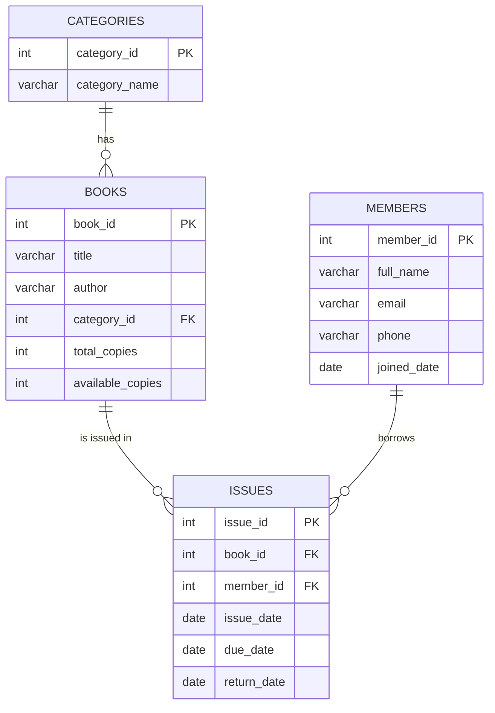

# Library Management System (MySQL)

A beginner-friendly **database design project** for a small library. It covers table design, relationships, triggers, a view and useful SQL queries.

## Features
- 4 normalized tables with primary and foreign keys
- Constraints: `NOT NULL`, `UNIQUE`, `CHECK`
- **Trigger** that reduces available copies when a book is issued
- **Trigger** that increases available copies when a book is returned
- **View** (`overdue_books`) that lists late books and calculates a fine (Rs. 2 per day)
- 8 ready-to-run queries using `JOIN`, `GROUP BY`, `HAVING`, `LEFT JOIN` and `LIKE`

## ER diagram


## Files
| File | Purpose |
|---|---|
| `schema.sql` | Creates the database, tables, triggers and view |
| `sample_data.sql` | Adds sample books, members and issue records |
| `queries.sql` | Example queries to practice |

## How to run
1. Install MySQL 8 (or MariaDB) and open a terminal.
2. Run the files in this order:
   ```
   mysql -u root -p < schema.sql
   mysql -u root -p < sample_data.sql
   mysql -u root -p < queries.sql
   ```
   (Or open the files in MySQL Workbench and run them.)

## Sample query
```sql
-- Overdue books with fine
SELECT * FROM overdue_books ORDER BY days_late DESC;
```
> The overdue results depend on today's date, so the late days and fines change every day.

## Concepts practised
- Normalization (no repeated data)
- One-to-many relationships
- Triggers and views
- Aggregate functions and grouping

## Future improvements
- Add a `fines` table and payment records
- Add a stored procedure for issuing books with checks
- Connect it to a Java (JDBC) or C# application

## Author
Dhruv Patel | MSc IT
